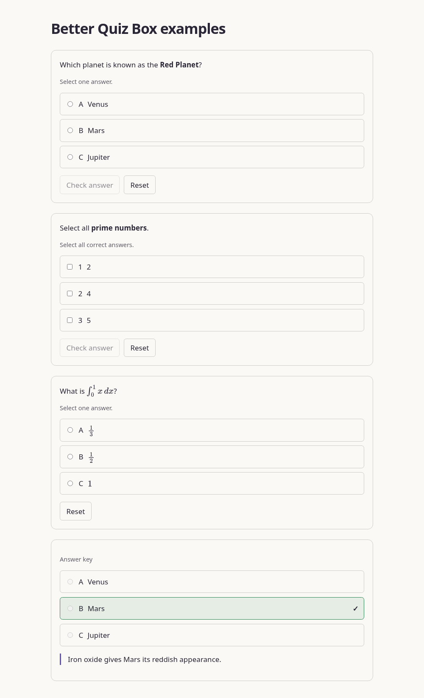
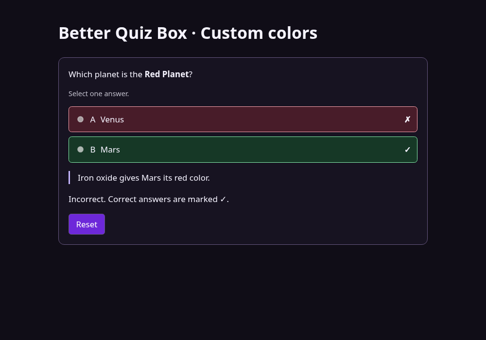

# Better Quiz Box for Digital Garden

Publish interactive `quiz` fences written for [junzi-ana/better-quizbox](https://github.com/junzi-ana/better-quizbox) on the [Digital Garden Eleventy template](https://github.com/oleeskild/digitalgarden). This is an independent web adaptation, not the Obsidian plugin itself.



## Install

Copy this directory as `src/plugins/better-quizbox/` in your garden. Its `garden-plugin.json` must be directly inside that folder. Restart the garden build/dev server and republish your notes. Installation requires no extra npm dependencies or setup scripts.

The garden must support the plugin manifest and hook API described in the template's garden-plugin-author skill. Older templates without that API need updating first.

To disable it, merge `"better-quizbox": {"enabled": false}` into the `plugins` object in `src/plugins/plugins.json`.

## Write a quiz

````markdown
```quiz
<!-- id: planet01, mode: non-immediate, shuffle: off -->
Which planet is the **Red Planet**?
[ ] Venus
[c] Mars
[ ] Jupiter
[h] Iron oxide gives Mars its red color.
```
````

Use `[c]` for correct answers, `[ ]` for distractors, and an explicit `[h]` for the explanation. Continuation lines belong to the previous option until another option or `[h]`. The parser follows upstream source behavior here, which differs from the upstream README's description of implicit explanations. Identical options are deduplicated, ignoring case. See [example.md](example.md) for more examples.

- `mode: non-immediate`: select, then check. Multiple `[c]` markers require selecting every correct answer and no distractors.
- `mode: immediate`: each selection gives feedback; any marked correct option counts as correct.
- `mode: static`: show the answer key without interaction.
- `shuffle: on/off`: shuffle on each page load, except static blocks.
- `number: abc/123/none`: option labels.
- `submit: off`: selection without grading, useful for flashcards.
- `id: planet01`: explicit identity for same-page references.
- `bind: planet01`: a read-only answer key for that question.
- `copy: planet01`: another interactive instance of that question.
- `stem: off`: hide the question stem.

Use unique IDs and one original question per ID on a page. Reference IDs follow upstream validation: 4–10 base36 characters, optionally followed by `-` and digits. Referenced blocks share option order on the page but have independent selections. Missing, duplicate, chained, and cross-page references produce a readable message instead of failing the build.

Markdown and LaTeX render in stems, options, and explanations. Raw HTML is escaped. Math uses the template's bundled MathJax dependency. Native form controls support keyboard navigation; feedback uses a live region and check/cross symbols. Without JavaScript the answer key is visible.

## Site settings

Merge settings into `src/plugins/plugins.json`:

```json
{
  "plugins": {
    "better-quizbox": {
      "enabled": true,
      "settings": {
        "mode": "non-immediate",
        "shuffle": true,
        "number": "abc",
        "submit": true
      }
    }
  }
}
```

Block attributes override these defaults. Styles use garden theme variables with fallbacks.

## Scope

Answers exist only in browser memory and reset on reload/navigation. The Reset button clears selections without reshuffling. The upstream `reset` attribute is parsed for compatibility, but both values reset on a full page load; persistent manual-reset state is not implemented. Hints appear after selection in immediate mode and after checking in submit mode. Static blocks always show hints.

No vault-wide indexing, ID rewriting, favorites, spaced-repetition scheduling, external answer-paragraph extraction (`answer-paras`), custom verdict templates, or Obsidian settings synchronization. No analytics, network requests, or note edits. Answers are present in published HTML, so use this for study rather than secure exams.

## Publish as a garden plugin

Place the contents of this directory at the root of a public repository, such as `garden-plugin-better-quizbox`. Review the author field, then tag `v1.1.0`. Users can install through its repository URL. For the community directory, submit an entry to `oleeskild/digitalgarden-plugins/community-plugins.json` using `screenshot.png`.

## License and attribution

MIT. The parser in `lib/parse.js` is adapted from Better Quiz Box by junzi-ana (小号菌子ana); its copyright and license are retained in LICENSE. The garden hooks, browser code, and styles are an independent adaptation.

## Colores personalizados (v1.1.0)

En los ajustes del plugin puedes definir los colores del fondo, texto, bordes,
selección, aciertos, errores y botones. Se aceptan colores hexadecimales
`#RGB`, `#RGBA`, `#RRGGBB` y `#RRGGBBAA`. Un campo vacío o inválido conserva
el color predeterminado. Los cambios se aplican a todos los quizzes al
reiniciar el servidor y reconstruir el jardín; los visitantes no cambian la paleta.

Ejemplo para `src/plugins/plugins.json` (combina estos campos con tus ajustes existentes):

```json
{
  "plugins": {
    "better-quizbox": {
      "enabled": true,
      "settings": {
        "backgroundColor": "#171321",
        "textColor": "#f5f3ff",
        "borderColor": "#675780",
        "accentColor": "#c4b5fd",
        "selectedColor": "#3b2b59",
        "correctColor": "#86efac",
        "correctBackgroundColor": "#163826",
        "incorrectColor": "#fda4af",
        "incorrectBackgroundColor": "#481c29",
        "buttonColor": "#6d28d9",
        "buttonTextColor": "#ffffff"
      }
    }
  }
}
```

Deja todos los campos de color vacíos para volver a usar el tema del jardín.
Elige combinaciones con suficiente contraste para mantener legible el texto.


